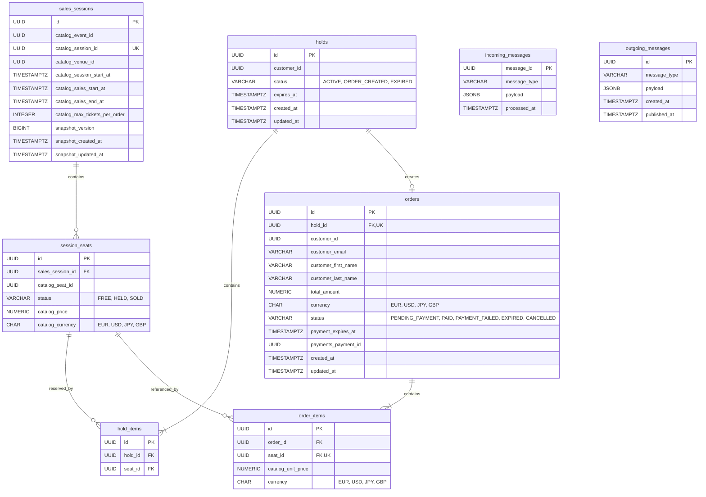

# Sales Service --- Database Design

## Running the project

To run the project, **Docker** must be running and the `.env` file must be configured with the required credentials (use `.env.example` as a reference). All commands are run through the **`deploy`** script located in the **`scripts/`** folder: `deploy.bat` on Windows, `deploy.sh` on Linux and macOS. The scripts work from any directory, because they move to the project root on their own.

On Linux and macOS, make the script executable (only once):

```bash
chmod +x scripts/deploy.sh
```

### 1. Local run (Development)

1. Open a terminal (using **IntelliJ IDEA** is recommended) and run the script to start the local infrastructure:

   **Windows:**

   ```bat
   scripts\deploy.bat local
   ```

   **Linux / macOS:**

   ```bash
   ./scripts/deploy.sh local
   ```

   If you do not specify a parameter, the default mode is `local`. This command starts the **PostgreSQL** and **pgAdmin** containers using the variables defined in the `.env` file.

2. Once the script has finished, start the **Spring Boot** application directly from IntelliJ.

3. On startup, **Flyway** automatically applies the database schema and loads an initial batch of test data.

#### pgAdmin configuration

1. Open pgAdmin in your browser (`http://localhost:5050`) and log in with the email and password set in `.env`.

2. Add a new server (*Add New Server*):

    * **General -> Name**: choose any name (e.g. `Sales DB`).

    * **Connection -> Host name/address**: enter `sales-db` (or `sales-<name of the postgresql container>`).

    * **Connection -> Username / Password**: enter the database credentials defined in `.env`.

---

### 2. Production run

Run the script with the `prod` option:

**Windows:**

```bat
scripts\deploy.bat prod
```

**Linux / macOS:**

```bash
./scripts/deploy.sh prod
```

In this mode:

* The image is built with `--build` (the Gradle build runs inside the Dockerfile).

* The local test data (`dev-data`) is **not** loaded.

* **pgAdmin** is neither downloaded nor started.

* The application is available at `http://localhost:8080`.

---

### 3. Stopping the services

To stop the containers and clean up the environment (including the volumes, for both `local` and `prod` modes):

**Windows:**

```bat
scripts\deploy.bat down
```

**Linux / macOS:**

```bash
./scripts/deploy.sh down
```

**Warning:** this command also removes the volumes, so all database data will be lost.

To view the application logs in production:

```bash
docker compose -f docker-compose.prod.yaml logs -f sales
```

### 4. Running together with other services

To start Sales together with other microservices (for example `sales_rabbitmq`), use the setup script of the `configuration` repository, which handles cloning, starting and stopping the combined environments.

## 1. Relational schema

The diagram shows the relationships internal to the Sales database. The `catalog_*` and `payments_*` identifiers are references to external systems and, intentionally, have no foreign keys.



## 2. Tables

### 2.1 `sales_sessions`

Represents the **local snapshot of a Catalog session** that Sales needs in order to manage sales without querying Catalog during checkout.

| Column | Meaning |
|---|---|
| `id` | Sales-internal UUID identifier |
| `catalog_event_id` | Event ID in Catalog |
| `catalog_session_id` | Session ID in Catalog |
| `catalog_venue_id` | Venue ID in Catalog |
| `catalog_session_start_at` | Session start date and time |
| `catalog_sales_start_at` | Sales opening |
| `catalog_sales_end_at` | Sales closing |
| `catalog_max_tickets_per_order` | Maximum number of tickets per order |
| `snapshot_version` | Snapshot version applied by Sales |
| `snapshot_created_at` | Snapshot creation |
| `snapshot_updated_at` | Last snapshot update |

### 2.2 `session_seats`

Contains one row for each sellable seat associated with a session. Sales keeps **only the commercial information**, not the floor plan geometry or the seat's graphical data.

| Column | Meaning |
|---|---|
| `id` | Internal UUID identifier of the session/seat combination |
| `sales_session_id` | FK to `sales_sessions.id` |
| `catalog_seat_id` | Identifier of the physical seat in Catalog |
| `status` | Commercial availability: `FREE`, `HELD`, `SOLD` |
| `catalog_currency` | `EUR`, `USD`, `JPY`, `GBP` |
| `catalog_price` | Price received from Catalog in the snapshot |

The frontend can combine the seat map returned by Catalog with the availability and prices returned by Sales by using `catalog_seat_id`.

### 2.3 `holds`

Represents the temporary lock on the seats selected by a customer.

| Column | Meaning | Agreed states |
|---|---|---|
| `id` | UUID identifier | - |
| `customer_id` | Customer who owns the HOLD | - |
| `status` | HOLD status | `ACTIVE`: active HOLD.<br>`ORDER_CREATED`: an order has been created from the HOLD.<br>`EXPIRED`: expired HOLD. |
| `expires_at` | Lock expiration | - |
| `created_at` | Creation | - |
| `updated_at` | Last modification | - |

If the customer closes the browser, the backend does not try to detect it: the HOLD remains active until it expires. A backend process takes care of expiring HOLDs.

### 2.4 `hold_items`

Associates seats with a HOLD.

| Column | Meaning |
|---|---|
| `id` | UUID identifier |
| `hold_id` | FK to `holds.id` |
| `seat_id` | FK to `session_seats.id` |

Creating a HOLD must check and update the seats atomically: only seats with status `FREE` can move to `HELD`. The check must be safe under concurrent requests.

### 2.5 `orders`

Represents the commercial order created from a HOLD.

| Column | Meaning | Agreed states |
|---|---|---|
| `id` | UUID identifier | - |
| `hold_id` | FK to `holds.id`, unique | - |
| `customer_id` | Customer identifier | - |
| `customer_email` | Snapshot of the email at the time of the order | - |
| `customer_first_name` | Snapshot of the first name | - |
| `customer_last_name` | Snapshot of the last name | - |
| `total_amount` | Total order amount | - |
| `currency` | ISO 4217 currency code, for example `EUR` | - |
| `status` | Order status | `PENDING_PAYMENT`<br>`PAID`<br>`PAYMENT_FAILED`<br>`EXPIRED`<br>`CANCELLED` |
| `payment_expires_at` | Expiration of the time allowed for payment | - |
| `payments_payment_id` | Payment ID in Payments, nullable | - |
| `created_at` | Creation | - |
| `updated_at` | Last modification | - |

At creation time, `holds.expires_at` and `orders.payment_expires_at` may receive the same timestamp. After the order is created, the payment process is governed by the order's expiration.

### 2.6 `order_items`

Contains one row for each seat associated with the order.

| Column | Meaning |
|---|---|
| `id` | UUID identifier |
| `order_id` | FK to `orders.id` |
| `seat_id` | FK to `session_seats.id`, unique |
| `catalog_unit_price` | Unit price captured at the time of the order |
| `currency` | ISO 4217 currency code (`EUR`, `USD`, `JPY`, `GBP`) |

### 2.7 `incoming_messages`

Records the messages received from the other microservices and already processed by Sales. It guarantees idempotency: if the same message is delivered more than once, Sales recognizes the already-recorded ID and does not repeat the processing.

| Column | Meaning |
|---|---|
| `message_id` | Original message ID, PK |
| `message_type` | Type of the received message |
| `payload` | Original message content, JSONB |
| `processed_at` | Processing timestamp |

Recording the message, updating the business data and any insertion into `outgoing_messages` must happen in the same transaction. If the transaction fails, the message record is also rolled back and the broker can redeliver the message.

### 2.8 `outgoing_messages`

Records the messages generated by Sales that must be published to the message broker. It implements the Outbox side of the pattern.

| Column | Meaning |
|---|---|
| `id` | UUID identifier of the message, PK |
| `message_type` | Type of message to publish |
| `payload` | Message content, JSONB |
| `created_at` | Creation time |
| `published_at` | Time of confirmed publication; nullable |