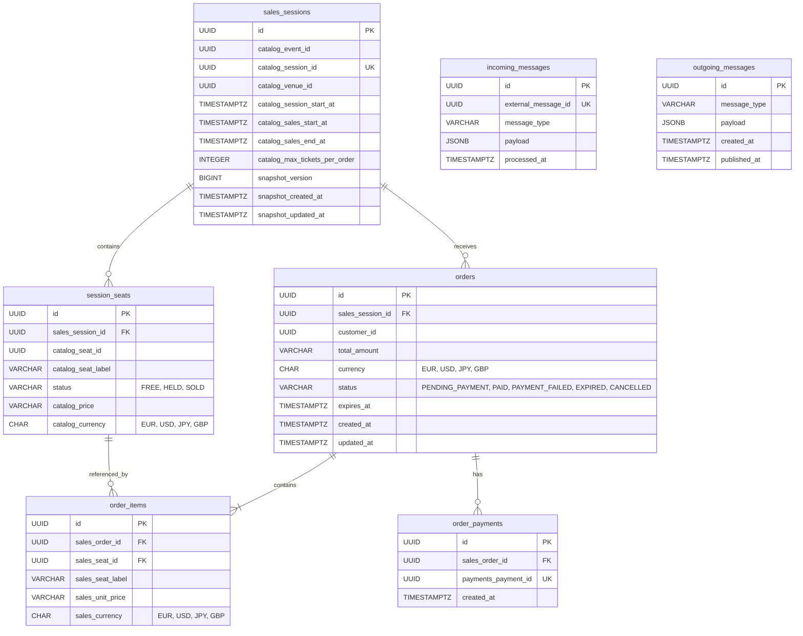

# Sales Service --- Database Design

## Running the project

To run the project, **Docker** must be running and the `.env` file must be configured with the required credentials (use `.env.example` as a reference). All commands are run through the **`deploy`** script located in the **`scripts/`** folder: `deploy.bat` on Windows, `deploy.sh` on Linux and macOS. The scripts work from any directory, because they move to the project root on their own.

On Linux and macOS, make the script executable (only once):

```bash
chmod +x scripts/deploy.sh
```

### 1. Local run (Development)

1. Open a terminal (using **IntelliJ IDEA** is recommended) and run the script to start the local infrastructure:

   **Windows:**

   ```bat
   scripts\deploy.bat local
   ```

   **Linux / macOS:**

   ```bash
   ./scripts/deploy.sh local
   ```

   If you do not specify a parameter, the default mode is `local`. This command starts the **PostgreSQL** and **pgAdmin** containers using the variables defined in the `.env` file.

2. Once the script has finished, start the **Spring Boot** application directly from IntelliJ.

3. On startup, **Flyway** automatically applies the database schema and loads an initial batch of test data.

#### pgAdmin configuration

1. Open pgAdmin in your browser (`http://localhost:5050`) and log in with the email and password set in `.env`.

2. Add a new server (*Add New Server*):

   * **General -> Name**: choose any name (e.g. `Sales DB`).

   * **Connection -> Host name/address**: enter `sales-db` (or `sales-<name of the postgresql container>`).

   * **Connection -> Username / Password**: enter the database credentials defined in `.env`.

---

### 2. Production run

Run the script with the `prod` option:

**Windows:**

```bat
scripts\deploy.bat prod
```

**Linux / macOS:**

```bash
./scripts/deploy.sh prod
```

In this mode:

* The image is built with `--build` (the Gradle build runs inside the Dockerfile).

* The local test data (`dev-data`) is **not** loaded.

* **pgAdmin** is neither downloaded nor started.

* The application is available at `http://localhost:8080`.

---

### 3. Stopping the services

To stop the containers and clean up the environment (including the volumes, for both `local` and `prod` modes):

**Windows:**

```bat
scripts\deploy.bat down
```

**Linux / macOS:**

```bash
./scripts/deploy.sh down
```

**Warning:** this command also removes the volumes, so all database data will be lost.

### 4. Running together with other services

To start Sales together with other microservices (for example `sales_rabbitmq`), use the setup script of the `configuration` repository, which handles cloning, starting and stopping the combined environments.

## 1. Relational schema

The diagram shows the relationships internal to the Sales database. The `catalog_*` and `payments_*` identifiers are references to external systems and, intentionally, have no foreign keys. The `sales_*` columns of `order_items` and `order_payments` are data owned by Sales or references to Sales' own tables.



## 2. Tables

### 2.1 `sales_sessions`

Represents the **local snapshot of a Catalog session** that Sales needs in order to manage sales without querying Catalog during checkout.

| Column | Meaning |
|---|---|
| `id` | Sales-internal UUID identifier |
| `catalog_event_id` | Event ID in Catalog |
| `catalog_session_id` | Session ID in Catalog, unique |
| `catalog_venue_id` | Venue ID in Catalog |
| `catalog_session_start_at` | Session start date and time |
| `catalog_sales_start_at` | Sales opening |
| `catalog_sales_end_at` | Sales closing |
| `catalog_max_tickets_per_order` | Maximum number of tickets per order |
| `snapshot_version` | Snapshot version applied by Sales |
| `snapshot_created_at` | Snapshot creation |
| `snapshot_updated_at` | Last snapshot update |

### 2.2 `session_seats`

Contains one row for each sellable seat associated with a session. Sales keeps **only the commercial information**, not the floor plan geometry or the seat's graphical data.

| Column | Meaning | Agreed states |
|---|---|---|
| `id` | Internal UUID identifier of the session/seat combination | - |
| `sales_session_id` | FK to `sales_sessions.id` | - |
| `catalog_seat_id` | Identifier of the physical seat in Catalog | - |
| `catalog_seat_label` | Human-readable label of the seat, received from Catalog | - |
| `status` | Commercial availability | `FREE`: available for purchase.<br>`HELD`: locked by an order in `PENDING_PAYMENT`, until the order expires or is paid.<br>`SOLD`: purchased (order `PAID`). |
| `catalog_currency` | `EUR`, `USD`, `JPY`, `GBP` | - |
| `catalog_price` | Price received from Catalog in the snapshot | - |

The pair (`sales_session_id`, `catalog_seat_id`) is unique. The frontend can combine the seat map returned by Catalog with the availability and prices returned by Sales by using `catalog_seat_id`.

### 2.3 `orders`

Represents the commercial order. An order is created at **checkout**, when the customer confirms the selected seats: in the same transaction the seats are locked (`HELD`) and the payment timer starts. Selecting seats before checkout is not persisted and does not lock anything.

| Column | Meaning | Agreed states |
|---|---|---|
| `id` | UUID identifier | - |
| `sales_session_id` | FK to `sales_sessions.id` | - |
| `customer_id` | Customer identifier | - |
| `total_amount` | Total order amount | - |
| `currency` | ISO 4217 currency code (`EUR`, `USD`, `JPY`, `GBP`) | - |
| `status` | Order status | `PENDING_PAYMENT`<br>`PAID`<br>`PAYMENT_FAILED`<br>`EXPIRED`<br>`CANCELLED` |
| `expires_at` | Expiration of the time allowed for payment | - |
| `created_at` | Creation | - |
| `updated_at` | Last modification | - |

`expires_at` is the single timer of the purchase flow: it is computed by Sales at checkout (current time plus the configured duration) and stored, so that orders already created keep their original deadline if the duration changes.

Payment processing is managed by the Payments service. Sales only keeps the reference to the external payment in `order_payments`.

### 2.4 `order_payments`

Tracks the payments of the external Payments service associated with an order. An order can have more than one payment (for example a failed attempt followed by a retry before the order expires).

| Column | Meaning |
|---|---|
| `id` | UUID identifier |
| `sales_order_id` | FK to `orders.id` |
| `payments_payment_id` | Payment ID in Payments, unique, no foreign key |
| `created_at` | Creation |

The unique constraint on `payments_payment_id` prevents the same external payment from being linked more than once. When the link is created from a message or webhook, the insertion must be idempotent.

### 2.5 `order_items`

Contains one row for each seat associated with the order.

| Column | Meaning |
|---|---|
| `id` | UUID identifier |
| `sales_order_id` | FK to `orders.id` |
| `sales_seat_id` | FK to `session_seats.id`; the pair (`sales_order_id`, `sales_seat_id`) is unique |
| `sales_seat_label` | Seat label captured by Sales at the time of the order |
| `sales_unit_price` | Unit price captured by Sales at the time of the order |
| `sales_currency` | ISO 4217 currency code (`EUR`, `USD`, `JPY`, `GBP`) captured by Sales at the time of the order |

Price, currency and seat label are a historical snapshot and do not change if the Catalog data is updated later. At checkout, Sales copies `session_seats.catalog_seat_label`, `catalog_price` and `catalog_currency` into `order_items.sales_seat_label`, `sales_unit_price` and `sales_currency`. The same seat can appear in several orders over time (for example after an order expired), but exclusivity at any given moment is guaranteed by `session_seats.status`.

### 2.6 `incoming_messages`

Records the messages received from the other microservices and already processed by Sales. It guarantees idempotency: if the same message is delivered more than once, Sales recognizes the already-recorded external ID and does not repeat the processing.

| Column | Meaning |
|---|---|
| `id` | Sales-internal UUID identifier, PK, generated by the database |
| `external_message_id` | Message ID assigned by the sender, unique; it is the idempotency key |
| `message_type` | Type of the received message |
| `payload` | Original message content, JSONB |
| `processed_at` | Processing timestamp, set by the application (defaults to the current time) |

The unique constraint on `external_message_id` (`uq_incoming_messages_external_message_id`) is what makes the insertion idempotent. The message is inserted with `INSERT ... ON CONFLICT (external_message_id) DO NOTHING`: if no row is inserted, the message is a duplicate and is ignored without raising an error, so the transaction remains usable.

The transaction is opened by the event handler, so that the inbox insertion, the update of the business data and any insertion into `outgoing_messages` are committed or rolled back together. If processing fails, the inbox row is rolled back as well, the exception propagates to the listener and the broker can redeliver the message.

### 2.7 `outgoing_messages`

Records the messages generated by Sales that must be published to the message broker. It implements the Outbox side of the pattern.

| Column | Meaning |
|---|---|
| `id` | UUID identifier of the message, PK |
| `message_type` | Type of message to publish |
| `payload` | Message content, JSONB |
| `created_at` | Creation time |
| `published_at` | Time of confirmed publication; nullable |

## 3. Purchase flow and expirations

1. **Seat selection.** The customer selects the seats on the map. The selection is only an intention: nothing is stored and no seat is locked. The map is kept up to date in real time through the seat events published by Sales.

2. **Checkout.** In a single transaction Sales:
   * locks the requested `session_seats` rows (always in the same order, to avoid deadlocks);
   * moves them from `FREE` to `HELD` only if all of them are `FREE`; otherwise the whole operation is rolled back and the customer is told which seats are no longer available;
   * creates the `orders` row (`PENDING_PAYMENT`, with `expires_at`) and the `order_items` rows with the price, currency and seat label snapshot;
   * inserts the corresponding messages into `outgoing_messages`.

3. **Payment.** When the Payments service confirms the payment, Sales first records the message in `incoming_messages` (duplicates are ignored). Then, in the same transaction, the order becomes `PAID`, the seats become `SOLD`, the payment is linked in `order_payments` and a message is emitted.

4. **Expiration.** A backend process looks for orders in `PENDING_PAYMENT` with `expires_at` in the past, moves them to `EXPIRED`, sets their seats back to `FREE` and emits the messages that update the map. The same release of the seats applies to orders that become `CANCELLED` or `PAYMENT_FAILED`.